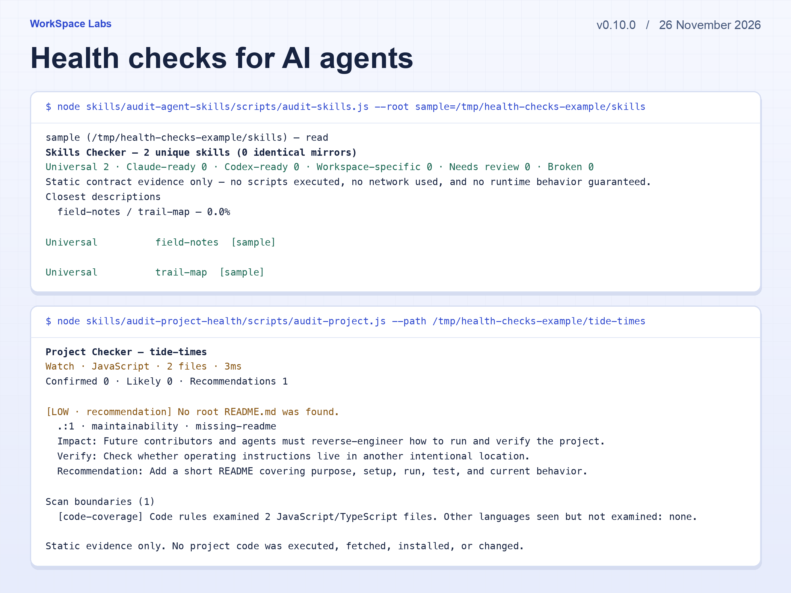

# Health checks for AI agents

**An agent is only as good as the instructions it loads and the code it opens. Almost nobody checks either.**



This is a working pattern for auditing both — with two read-only checkers that produce evidence a person can act on, and no authority to change anything they find.

It is tool-agnostic. Nothing here depends on a particular model, CLI, or framework.

Both checkers are in this repo — [`skills/`](skills). Two dependency-free Node scripts you can run in a minute.

---

## The problem, twice

### The toolbox rots, and it doesn't look like rot

Agents choose a tool by reading its description. So the moment two tools describe overlapping jobs, the choice between them stops being predictable — and that failure doesn't present as a duplicate. It presents as a *random bug*: the same request works on Monday and does something strange on Thursday, and you go looking in the wrong place.

It happens easily. Skills arrive from different sources, get installed months apart, and nobody re-reads the descriptions as a set. An audit of one working toolbox today: **34 skills, and two of them still share a single name.**

The same blind spot hides slower problems. A tool can ship bundled code that runs shell commands, reach the network, point at a reference file that isn't there, or link out of its own folder through a symlink. None of that is visible from the one line an agent reads before loading it.

### The person approving can't see the state of the code

Before you let an agent change a project, the useful question is *what's already fragile here* — broken local references, untested paths, patterns that swallow errors, files nobody imports any more.

Asking the agent that is about to do the work is not an answer. That's an opinion produced by the thing being judged. And if the person holding the decision doesn't read code — very often they don't, and shouldn't have to — they have no way to form their own.

---

## The pattern: two doctors, both read-only

| Checker | Reads | Reports |
|---|---|---|
| **Skills doctor** | The instructions agents load | Structure, trigger wording, safety signals, portability, cross-model compatibility |
| **Projects doctor** | JavaScript and TypeScript projects | Structure, broken local references, risky patterns, testing gaps, performance signals, maintainability |

Every project report counts the JavaScript and TypeScript files its code rules examined and names other recognized languages it saw. A Python-only or Go-only project gets a coverage finding and a **Watch** status. A mixed project gets a coverage notice.

**Two, not one.** Instructions and source code are different material with different risks, and one report that mixes them serves neither. Separate checkers get precise triggers, tighter boundaries, and a report you can read in one sitting.

---

## Run them

Both checkers live in [`skills/`](skills). They are plain Node scripts — no dependencies, no install step, no network access. Use a trusted clone outside the project you check.

```bash
git clone https://github.com/workspace-labs/agent-health-checks.git
cd agent-health-checks

# check the instructions your agents load
node skills/audit-agent-skills/scripts/audit-skills.js

# check the code before an agent changes it
node skills/audit-project-health/scripts/audit-project.js --path /absolute/project/path
```

Add `--json` for a machine-readable report. Run either script with `--version` alone to print its release. The [report format](REPORT-FORMAT.md) lists the fields and exit codes for each checker.

The skills checker’s default JSON includes byte counts for the instruction body and frontmatter. Use `--json --include-body` to include their full values. On a default run, **Not checked** lists other skill locations and counts their `SKILL.md` files. A partial count is a lower bound. Only requested roots receive verdicts. To audit a listed location, pass its path with `--root`.

**Before installing a skill**, set `CANDIDATE` to the new skill’s folder and `COLLECTION` to an installed skills folder. Compare them together from the trusted clone.

```bash
node skills/audit-agent-skills/scripts/audit-skills.js --root "candidate=$CANDIDATE" --root "collection=$COLLECTION" --json
```

The `--root` options replace all default roots. Add another labelled `--root` for each additional installed folder. A `duplicate-name` finding identifies a name clash. **Closest descriptions** (`summary.closestPairs` in JSON) ranks possible job clashes for a person to judge.

Skills exit codes are **0** after a completed scan with no Broken skill or open command safety finding, **2** for a Broken skill or an open `destructive-command`, `code-execution` or `network-access` finding, and **1** for an unavailable explicit root, zero skills across all explicit roots, invalid usage or checker failure. Standalone help and version exit 0.

The project checker accepts `--path`, `--id`, `--name`, `--profile workspace` and four positive whole-number limits: `--max-files`, `--max-file-bytes`, `--max-total-bytes` and `--max-duration-ms`. Value options accept both a space and an equals sign. Choose a project folder. The checker refuses filesystem roots, the home folder and every ancestor of home. Folders inside home are accepted. The optional workspace profile enables exclusions for the owner's app layout. The default checks those paths as ordinary project content.

Project exit codes are **0** for Healthy or Watch, **2** for Needs attention and **1** for usage errors or an Unavailable report. Standalone help and version exit 0.

Run the tests from the clone. Verified on Node 20.20.2, 22.23.1, 24.22.1, and 26.13.1.

```bash
node --test
```

How often they were tested, the results, and what was never tested: [TESTING.md](TESTING.md).

To install both skills for Claude Code, run these commands from the clone.

```bash
mkdir -p "$HOME/.claude/skills/audit-agent-skills" "$HOME/.claude/skills/audit-project-health"
cp -R skills/audit-agent-skills/. "$HOME/.claude/skills/audit-agent-skills/"
cp -R skills/audit-project-health/. "$HOME/.claude/skills/audit-project-health/"
```

To update, first remove the two old skill folders, `~/.claude/skills/audit-agent-skills` and `~/.claude/skills/audit-project-health`. Then run the install commands above from the new release.

For Codex, put each skill folder in `~/.agents/skills` for personal use. Inside a repository, Codex checks `.agents/skills` at each directory from the working directory up to the repository root. [OpenAI’s local skill locations](https://learn.chatgpt.com/docs/build-skills#where-codex-loads-local-skills)

Neither script executes what it inspects, reaches the network, or writes to anything it reads.

---

## What makes a checker worth trusting

**It never runs what it inspects.** Static evidence only — no executing bundled scripts, no network, no installs. You are inspecting something you don't yet trust; running it first is the wrong order.

**Every finding carries a location.** A finding you can't walk to is a rumour. Project findings give a file and line, the check that raised the finding, its impact, how to verify it, and a recommended next step. A finding that counts several occurrences may point to just one location. Skill findings give the check area, severity, location, and a message. The skills JSON also includes the rule code and a suggestion. The terminal shows up to eight findings per skill.

**The project checker labels its own certainty.** *Confirmed* (proven by the evidence), *likely* (a real risk still needing a runtime check), *recommendation* (an improvement, not a bug). A scanner that states everything at the same volume gets ignored at the same volume. The skills checker uses the severity labels *error* and *review*.

**It fails closed and stays honest about its edges.** A link escaping its own folder is refused and reported, not followed. Scans are bounded — and whatever got skipped for size stays visible in the report rather than quietly counting as clean.

**It says what it cannot prove.** A clean static report is not proof of runtime safety. Saying so is what keeps the clean reports meaningful.

---

## Diagnosis is not treatment

This is the load-bearing rule: **the checker has no power to fix anything.** This repository contains the two read-only checkers. Their work ends with a report.

In the author's own workflow outside this repository, a fresh scan supplies the evidence for a repair task. A person approves the task before the repair starts. The author then backs up the affected files, checks the change, and scans again to compare the results.

Two reasons it's built that way. A scanner that can also repair will eventually repair something it misdiagnosed, confidently and at scale. And the evidence a person approves has to be the evidence *as of the approval* — not a screenshot of last week's scan, which is how you end up authorising a fix for a problem that has already moved.

---

## Why this got built

Neither checker was designed in the abstract. Both are scar tissue.

**The skills doctor** came from losing whole working sessions to a problem that never announced itself. Two tools quietly competed for the same job; the symptom was inconsistency, not duplication, so the search always started somewhere else. It happened more than once — including with a well-known skill, hundreds of thousands of installs deep, that turned out to do the same job as a tool already installed. The rule that came out of it (*search before you build a new tool*) was the obvious half. The audit is the half with teeth, because a rule is a request and a check is a result.

**The projects doctor** came from one sentence: *"I'm not a developer — even if I read the code I won't understand it."* That's the honest position of most people approving AI work now, and it makes "do you approve this?" an unanswerable question. So the code got a checker that answers in plain language, with a location attached, before anything is changed.

The general lesson underneath both: **when the same shape of mistake keeps coming back, don't write a smarter rule — build the check.** Rules depend on someone remembering them at the exact moment they're inconvenient. Checks don't.

---

## What it costs

An honest accounting:

- **Audits produce noise.** That same toolbox reports nine items as *needs review* — and most of them are deliberate and fine. Somebody still has to read them, and a report nobody reads is worse than no report, because it looks like coverage.
- **Static analysis has a ceiling.** It sees structure and shape, not behaviour. It will never catch everything, and pretending otherwise is how a clean report becomes a false comfort.
- **It's another thing to maintain.** The checkers are software too, with their own bugs and their own blind spots.

**Worth it when:** more than one agent shares a toolbox, tools arrive from outside, or the person approving the work can't personally verify it.

**Not worth it when:** one agent, a couple of hand-written tools, nothing anyone else depends on. Read them yourself and move on.

---

## The shortest version

> Check the instructions before an agent loads them, and the code before an agent changes it. Keep the check read-only, evidence-backed, and honest about its own certainty — then make every fix pass through a person.

---

<sub>by Workspace Labs · Drawn from a working system, not a thought experiment.</sub>
